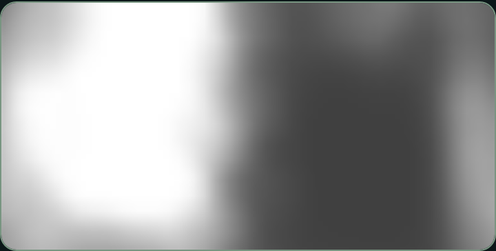
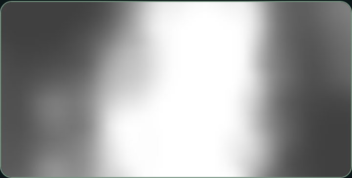
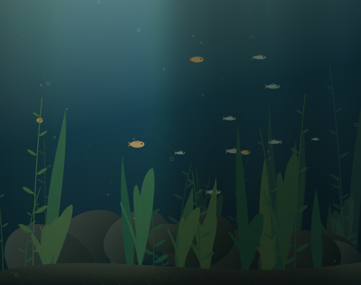
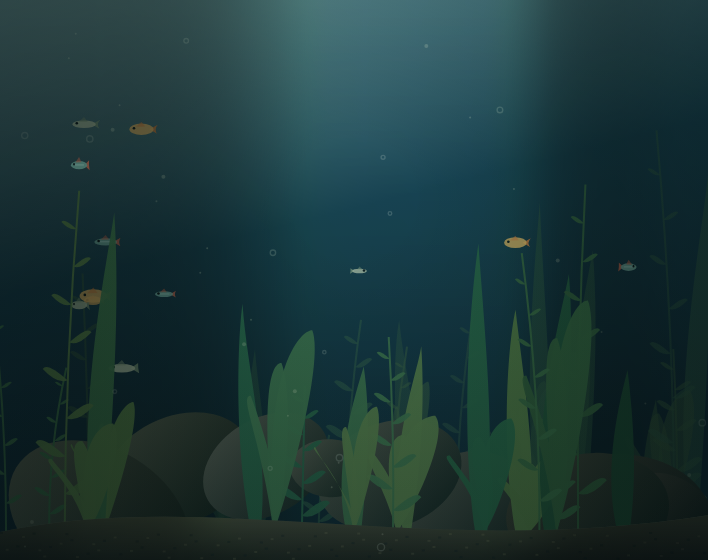

# Top-down light field and hardware mapping

> Historical implementation notes. See the [current lighting model](../README.md#global-lighting-and-dmx).

## Coordinates and projection

`LightingEngine.sample(state, x, y)` evaluates normalized tank coordinates: x = left→right; y = rear→front. `LightField` samples that continuous model into a reusable 96×48 buffer and provides bilinear interpolation. The buffer carries RGB radiance, five conceptual source channels (`red`, `green`, `blue`, `warmWhite`, `coolWhite`), cloud transmittance, and independent rear/front source contributions. Preset transitions interpolate every field channel.

The two simulated sources are centered at y = 0.22 and 0.78. Their influence is broad over the whole tank, with a mild quadratic falloff across depth. Each has independent gain, RGB multipliers and white-channel strengths; default front/rear white balances differ slightly. Cloud occlusion reduces their direct illumination with a diffuse floor, rather than drawing radial spotlights. The field can vary brightness and effective white balance in both axes.

Scene projection keeps a third coordinate, z, for distance below the water surface. Every plant, fish, rock and bubble has explicit approximate `worldY` metadata. Fish depth derives from its existing size/depth factor; plant foreground/background layers occupy separate depth ranges. Existing geometry, placement and animation are preserved. Material colors/plant gradients receive light at the object's x/worldY position, attenuated by z. The water/back wall is a rear plane. The visible floor alone uses a perspective depth mapping and a clipped spatial light map. It is never valid to equate the whole screen's vertical axis with front/rear position.

This remains a layered 2.5D illustration: plants/rocks use one approximate tank depth per object, not a reconstructed 3D mesh. The field supports higher fidelity geometry later without changing its coordinate contract.

## Cloud motion and developer view

Open `dev/light-map.html` relative to the deployed app or local server. It is not linked from the daily preset interface. Choose illumination or cloud transmittance; both views are overhead, with rear at the top and front at the bottom. Normal reduced-motion and hidden-tab behavior apply.

Clouds use two slowly advected fBm layers with velocities in **both** overhead axes and smooth coverage variation. A cached 40×24 transmittance mask is bilinearly sampled into the finer light field. Coordinates advance continuously; masks are not reseeded per frame. Cached lattice noise eventually repeats over hours, not a short visible cycle.

| Top-down transmittance, 0 s | Top-down transmittance, 30 s |
| --- | --- |
|  |  |

| Front-facing aquarium, 0 s | Front-facing aquarium, 30 s |
| --- | --- |
|  |  |

## Capability-based conversion

`mapLightField` in `js/hardware-mapping.js` is a pure function, re-exported by `js/hardware.js`. It does not connect to an ESP32 or transmit any data.

```js
import {LightingEngine} from './js/effects.js';
import {LightField} from './js/light-field.js';
import {getPreset} from './js/presets.js';
import {mapLightField, UNIFORM_CAPABILITIES} from './js/hardware.js';

const engine = new LightingEngine();
const field = new LightField();
field.update(engine, engine.state(getPreset('clouds'), 30));

// Two uniform assemblies; every available channel gets one averaged value.
const uniform = mapLightField(field);

// An example capability description, NOT a claim about the installed bars:
// segmented RGB, uniform warm white, absent cool white.
const hypothetical = UNIFORM_CAPABILITIES.map(assembly => ({
  ...assembly,
  segments: {red: 12, green: 12, blue: 12, warmWhite: 1, coolWhite: 0},
}));
const mixed = mapLightField(field, hypothetical);
// [{id:'rear', channels:{red:[...12], ..., warmWhite:[...1], coolWhite:[]}}, ...]
```

Each assembly defines a normalized rectangular tank footprint. Defaults split the tank into rear/front halves. Every channel independently declares 0 (unavailable), 1 (uniform), or N (left-to-right segments). Matching counts can describe grouped RGB addressing; white channels can stay uniform. Each segment averages its entire footprint using cell-centered quadrature. This preserves broad energy changes while avoiding aliasing a whole bar from one bright pixel. Segment values are normalized and bounded to 0–1; malformed footprints, counts and nonfinite samples are rejected. Footprints and per-channel calibration will need inspection of actual hardware.

Source requests exclude browser-only ambient visibility and water caustics. Storm's global flash also raises conceptual RGB/cool-white requests. These outputs are artistic target intensities, not measured lux, Kelvin, PWM, current or voltage. The mapper deliberately does not infer pinout, gamma, driver protocol, electrical limits or addressability. A future verified adapter must apply calibration, safe power limits, timing constraints, acknowledgements and state synchronization before physical output. Calling the mapper at a hardware-appropriate rate is separate from browser frame rendering.

Two uniform zones cannot reproduce the full 2D field. Multiple x segments improve horizontal detail; two front/rear rows still approximate continuous tank depth. If only some LED types are addressable, only their declared segments vary spatially. Previous left-to-right operation does not establish which RGB/white channels support it. No ESP32 communication or automatic connection is implemented.

## Validation and performance

Run `tests/browser.cjs`, `tests/lighting.cjs`, and `tests/field.cjs` as described in README. The field tests independently verify footprint averaging with an analytic x/y ramp, all-uniform and mixed channel counts, independent source/white controls, effective thermal variation, world-depth material differences, continuous clouds and developer view loading.

Pattern tracking after 15 seconds yielded mean transmittance errors of 0.0012 when advected in both axes, versus 0.0639 for x alone and 0.3081 for y alone. Maximum tested front/rear radiance contrast was 0.294. This checks actual two-axis travel, rather than only comparing two unrelated frames.

Cloud noise is generated at reduced resolution. The top-down field and image buffers are reused. Water samples are reused per column; invisible floor rows are skipped. DPR remains capped at 2, drawing at 30fps via timestamp-based requestAnimationFrame. Reduced motion and hidden-tab suspension are preserved.

At 354×280 CSS pixels / DPR 2, desktop Chromium runs measured approximately 5.8–6.1 ms median and 8.3–10.1 ms p95 CPU submission time over 90 frames. One run had a 59.4 ms outlier. These are shared-environment measurements, not GPU presentation, battery or iPhone Safari guarantees. Physical device testing remains outstanding. There is no build step or runtime dependency.
