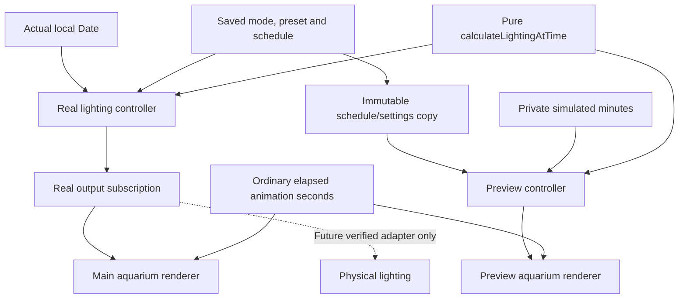
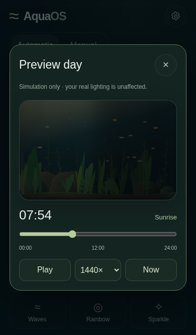
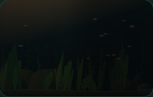
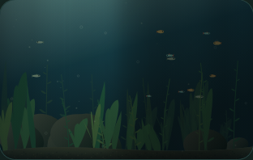
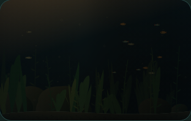

# Automatic daily cycle and isolated accelerated preview

## Clock and output boundary



`calculateLightingAtTime(time, schedule, settings)` has no clock, storage, renderer or hardware dependency. It accepts a local Date or minutes since midnight and returns phase, brightness, next transition and five global channel levels.

`createRealLightingController` owns a private actual-clock provider (Date by default). Only its `subscribeRealOutput` port is an allowed future hardware source. It samples persisted state and emits `{source:'real', at, mode, preset, cycle, channels}`. There is no clock setter. Tests inject a fixed real clock to prove preview actions cannot move it. The app samples the actual clock every 50 ms and immediately after real state changes/visibility restoration; automatic transitions use fractional minutes. Rendering does not produce controller commands.

`createPreviewController` accepts an immutable copy of schedule/settings and owns its own simulated minutes, playing flag and speed. It accepts **no hardware callback, real controller reference, store or persistence writer** and exposes no real-output subscription. Its output is tagged `source:'preview'`. Scrub, speed, Play/Pause, loop and Now operate on this private clock only. Opening/closing the sheet creates/destroys the simulation renderer and suspends/resumes the covered main canvas; it does not sample or publish real controller output. Independent real-controller ticks continue normally while the sheet is open.

The same `AquariumRenderer`, scene metadata, `LightingPass` and global channels are reused. The preview shares the existing scene geometry but owns its renderer and animation clock. Schedule updates use `setLighting`, which does not reset or replace the renderer's elapsed animation seconds. Playback advances `simulatedMinutes += elapsedSeconds * speed / 60`; weather variation also follows simulated time. Pausing stops schedule playback while decorative fish, plants and bubbles may continue. Reduced motion freezes the decorative scene; explicit Play can still demonstrate schedule changes. Hidden-tab gaps are excluded from preview playback. Closing discards all preview state and resumes the main scene at its current real lighting configuration.

No hardware communication is implemented. A future bridge must subscribe only to real output, map the global output at an appropriate hardware rate and enforce verified limits. It must never read the canvas, preview state or simulated time. The current application does not import or invoke a hardware adapter.

## Daily schedule

Default configuration (minutes are local wall-clock minutes):

```json
{
  "version": 2,
  "mode": "automatic",
  "presetId": "sunny",
  "schedule": {
    "sunriseStart": 360,
    "sunriseDuration": 180,
    "sunsetStart": 1080,
    "sunsetDuration": 180
  },
  "cycleSettings": {
    "dayBrightness": 0.8,
    "moonlightEnabled": false,
    "moonlightIntensity": 0.02
  }
}
```

Persistence uses the existing `aquaos.settings.v1` key with a version-2 payload, preserving old manual selections. Missing/invalid schedule data falls back to defaults; blocked/corrupt storage does not prevent use. Settings save only on successful form submission. Preview minutes, playback state and speed are never included. Real configuration can later be serialized for an ESP32, but timezone negotiation and synchronization are not implemented.

Start times are integral minutes 0–1439. Durations must be 1–720 minutes. Validation follows the cyclic order sunrise → daylight → sunset → night, with a nonzero interval for every phase; overlapping or zero-length phases are rejected. Valid schedules may cross midnight (for example sunrise 23:00–01:00, sunset 06:00–08:00). Brightness must be 0–100%; moonlight must be enabled explicitly and is limited to 0–5% conceptual intensity.

Smoothstep ramps give zero brightness slope at phase boundaries. Warm dawn/dusk tones blend continuously into balanced, cloudy daylight; RGB daylight is introduced gradually and conceptual warm-white/cool-white balance also changes smoothly while retaining front/rear offsets. Night has no direct or ambient illumination by default, and all mapped RGB/white channels are zero. Optional moonlight remains very dim. Background scattering also falls to zero when lighting is off. Automatic configs use a distinct ID, so the manual Sunrise/Sunset presets' animation-time envelopes cannot accidentally double-apply a scheduled ramp.

Schedules follow the browser's local wall clock, including its timezone and daylight-saving adjustments. A DST skip can skip part of a phase, and a repeated hour repeats that wall-clock segment. This is a daily wall-clock schedule, not a fixed UTC-duration schedule. Browser sleep/closure cannot provide autonomous physical control; a future ESP32 needs its own trustworthy clock and schedule execution.

## Validation

Run all four suites from README. `tests/schedule.cjs` checks:

- Default phases, exact boundaries, smooth radiance/channel transitions, midnight and a schedule spanning midnight.
- Invalid/overlapping schedules, night-off mapped channels, optional moonlight and persistence.
- Separate real and preview outputs using a fixed actual clock and a spy on the real-output subscriber.
- 60×/360×/1440× advancement, pause and looping without store writes or real-clock changes.
- Decorative animation staying in ordinary seconds during 1440× UI playback.
- Timeline/time/phase controls, returning to live view, manual preset fallback, schedule editing and validation.
- Automatic-mode phone layouts at 320×480 through 430×760, plus landscape.

The existing mobile, lighting and mapping suites continue to pass. The main canvas is suspended during preview to keep a single animated aquarium active; real state calculation continues. Chromium emulation does not prove physical iPhone Safari performance. Native time/number inputs use at least 16px text to avoid Safari focus zoom, and touch controls remain at least 44px. Short viewports and text enlargement may scroll dialogs to keep all controls reachable.

## Preview captures

Captured from the actual preview sheet in Chromium with the same aquarium renderer and scenery. Default schedule: 07:30 sunrise, 12:00 daylight, 19:30 sunset and 23:00 night. Night is intentionally dark with moonlight disabled.



| Sunrise | Daylight |
| --- | --- |
|  |  |

| Sunset | Night, lights off |
| --- | --- |
|  |  |
