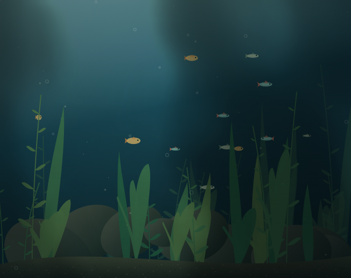
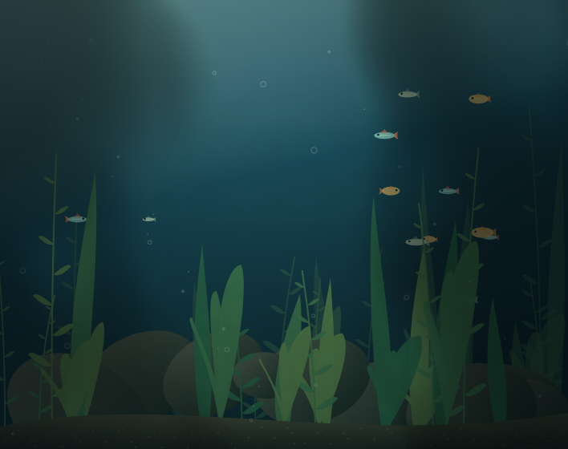
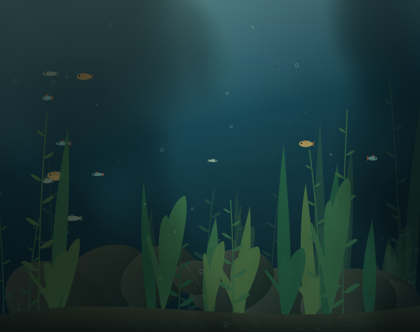
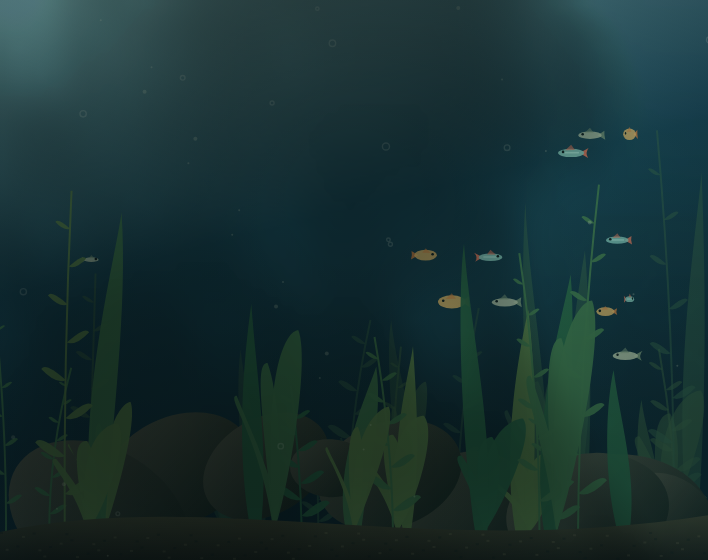
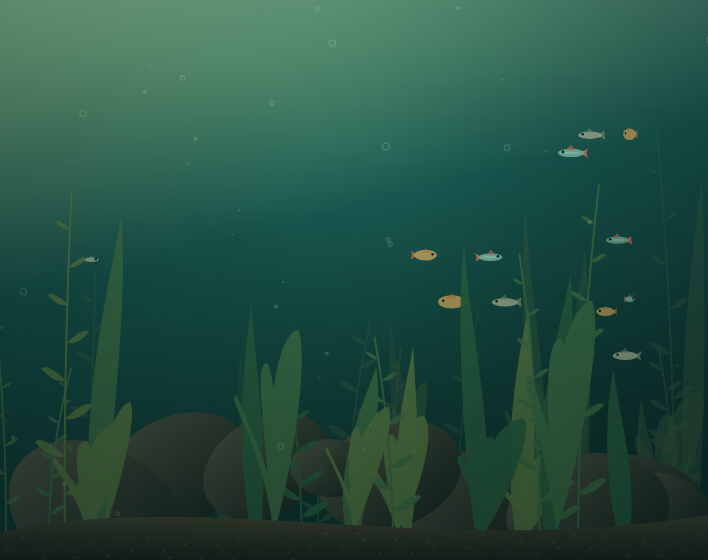
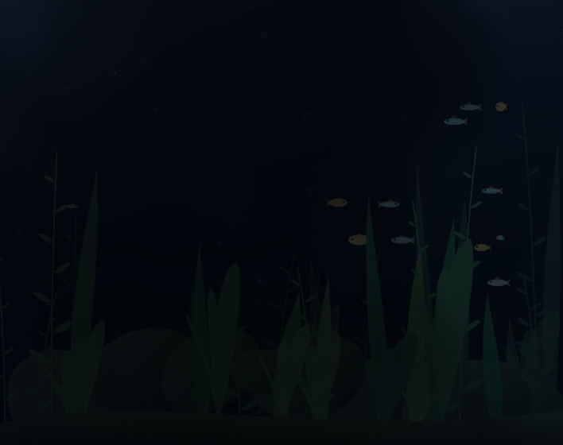
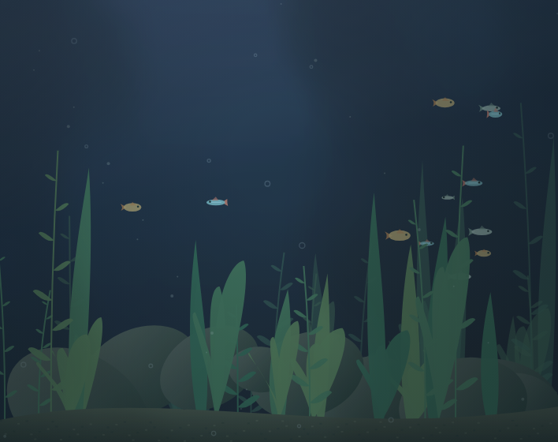

# Lighting validation

Captured using desktop Chromium, a 354×280 CSS-pixel canvas at DPR 2. Scenery is seeded identically in the test fixture to make comparisons repeatable. Fish and plants still move as time advances. No UI files or scenery geometry were changed by this lighting update.

## Clouds over time

| 0 seconds | 15 seconds |
| --- | --- |
|  |  |

| 30 seconds | 60 seconds |
| --- | --- |
|  |  |

The brighter opening moves from the left through the center and towards the right. Large shaded regions deform and move continuously; plants, rocks, fish and substrate darken with the water. Cloud transmittance is sampled from continuous coordinates; it is never regenerated on a frame boundary.

## Sunny and storm

| Storm between flashes | During a global flash |
| --- | --- |
|  |  |

Storm's sampled flash starts over two minutes were approximately 5.7, 18.0, 38.6, 57.1, 83.2 and 109.4 seconds, with some short secondary pulses. Reduced motion disables them entirely.

## Automated evidence

`tests/lighting.cjs` samples illumination over space and time and captures these frames. Checks include ambient visibility, spatial contrast, slow continuous motion over three minutes, independent caustic highlights, cloud attenuation of highlights, gradual sunrise/sunset, irregular lightning, delta-time frame drops, hidden-time exclusion and reduced-motion lightning suppression. `tests/browser.cjs` covers all existing preset buttons, layout, dialog, keyboard, persistence and reduced-motion still frames.

Representative final run:

- Mean absolute illumination change between 0 and 30 seconds: 0.245 (normalized RGB average).
- Maximum sample change in 1/30 second: 0.0018; maximum in 0.2 seconds across three minutes: 0.0181.
- Sampled shaded ambient baseline remained above 0.47. These are illumination multipliers, not displayed pixel luminance.
- A sampled caustic highlight fell from 0.0208 in direct sunlight to 0.0028 under cloud cover.
- New renderer CPU submission time: median 3.1 ms, p95 5.7 ms, maximum 8.2 ms over 90 frames. Previous renderer at the same size/DPR: median 0.9 ms, p95 2.5 ms. Measurements include scene drawing and light-map generation; they do not measure complete GPU presentation or battery cost. The richer model costs more CPU but remains below the 33.3 ms budget on this environment.

## Limits

This is a two-dimensional, artistic approximation of light transport: material colors are modulated by a common illumination field, with depth attenuation and low-energy scattering. It does not simulate 3D surface normals, refraction through glass, fish self-shadowing or calibrated spectral response. Caustics use reduced-resolution procedural highlights rather than a physical water-surface solver. The cached noise lattice eventually repeats over hours, not short visible loops.

Desktop Chromium and emulated phone layouts do not establish performance or appearance on physical iPhone Safari. Test there before claiming a device-specific frame rate. There is no hardware connection: the LiWeBe protocol, electrical characteristics and LED addressability are still unverified. Two real bars may support only aggregate channel changes and may not reproduce these spatial shadows; that decision belongs in a verified hardware adapter.
