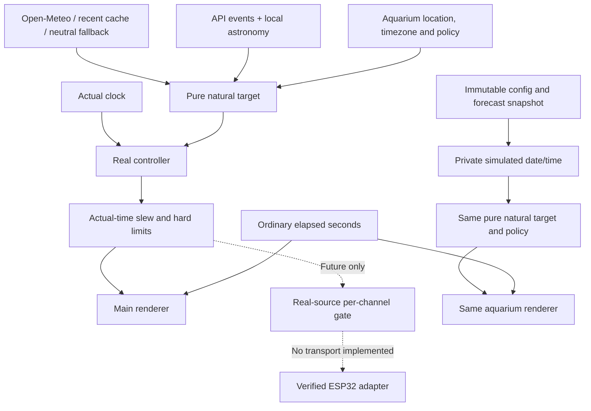
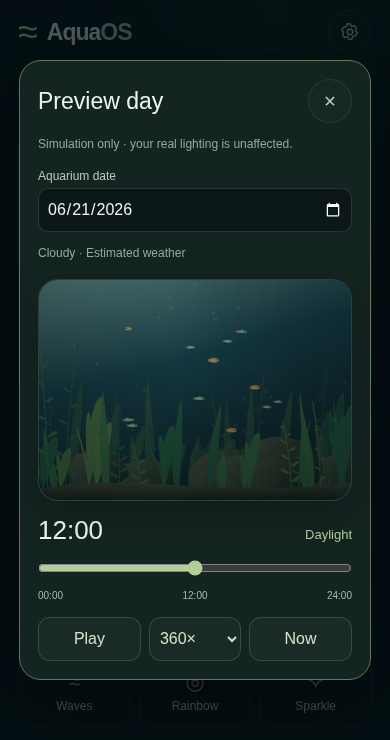

# Natural Mode: weather, astronomy and independent safety policy

## Data sources and exact API fields

Verified against the [official forecast documentation](https://open-meteo.com/en/docs) and a successful **browser-origin request** on 2026-11-07. The live response contained 192 hourly values and eight daily records (seven forecast days plus one past day). Requests specify the aquarium's configured IANA `timezone`, `timeformat=unixtime`, `wind_speed_unit=ms`, `forecast_days=7`, and `past_days=1`.

| API group | Requested fields | Units / interpretation |
| --- | --- | --- |
| `current` | `cloud_cover`, `precipitation`, `rain`, `weather_code`, `wind_speed_10m`, `wind_direction_10m` | %, mm, WMO code, m/s, meteorological degrees |
| `hourly` | All current fields, plus `cloud_cover_low`, `cloud_cover_mid`, `cloud_cover_high`, `shortwave_radiation` | Low/mid/high cloud fractions; hourly solar radiation in W/m² |
| `daily` | `sunrise`, `sunset`, `moonrise`, `moonset`, `moon_phase` | Unix seconds for events; phase fraction (0=new, 0.5=full, approaching 1=new) |

Unlike older Open-Meteo versions, the currently tested forecast endpoint **does return lunar daily fields**. If a deployment rejects them with HTTP 400, the provider retries daily sunrise/sunset only and uses local moon calculations. There are no invented API parameters or assumed lunar endpoints. Radiation has its documented hourly averaging semantics; it weakly influences a bounded weather factor and is not treated as instantaneous aquarium lux.

Manual city search uses the [documented geocoding API](https://open-meteo.com/en/docs/geocoding-api): `/v1/search?name=...&count=5&language=en&format=json`. The user explicitly selects a result, including its timezone, or enters coordinates/timezone manually. No browser geolocation is requested. No default aquarium coordinates are inferred from browser timezone, IP or the developer's location.

Open-Meteo data is attributed in Settings under CC BY 4.0. Network access is limited to the forecast and geocoding services; there is no backend or API key. Hosted/commercial deployments must use a service arrangement appropriate for their usage; the app does not provision an API subscription.

## Cache and failure handling

Weather cache keys include latitude, longitude and timezone. Current modeled conditions are used near the present; previews use hourly forecasts, smoothly interpolating numeric values and circular wind bearings. WMO codes select labels rather than being numerically interpolated. Layer/rain/radiation gaps receive conservative defaults.

Requests refresh at 15-minute intervals, deduplicate in-flight work, time out after ten seconds, and abort/discard old responses when the location changes. Valid cached forecasts remain usable offline for up to 24 hours. Missing, stale, invalid or out-of-range weather becomes labeled **Estimated** weather rather than stale values silently standing in for current conditions. Cache/storage failures do not prevent operation. Sun/moon calculations remain available offline.

Astronomy events are cached per location/day/dataset. Local fallback uses the vendored [SunCalc 1.9.0](https://github.com/mourner/suncalc/tree/v1.9.0) implementation with only its packaging converted to ESM. Its [BSD license](../js/vendor/suncalc.LICENSE) is included. API event times are preferred where valid; calculated horizon altitude is authoritative for whether the moon is actually above the horizon. This handles rise/set events straddling midnight or missing on polar dates without assuming that every night has both events. Phase is interpolated across available daily records, including the 1→0 wrap.

## Lighting window and safety precedence

Natural Mode uses actual sunrise/sunset to find the local solar-day midpoint, plus a configurable offset. At polar extremes, calculated solar noon remains the anchor. The aquarium window is centered there; it is **not** a claim that aquarium dawn equals outdoor sunrise. The main compact information explicitly labels outdoor events as **Sky sunrise/sunset**.

The independent policy in `js/safety.js` bounds Natural Mode, regardless of weather or astronomy values. Defaults are conservative configuration choices, not validated species-specific biological limits:

| Policy | Default |
| --- | --- |
| Total potential daily light budget | 9 hours, ramps/twilight/moon reserve included |
| Maximum requested controller brightness | 80% |
| Minimum continuous darkness | 12 hours |
| Weather output floor | 75% of the corresponding un-dimmed daylight request |
| Actual-output change limit | 2 percentage points per minute |
| Optional moonlight policy cap | 0.2% controller output; requested default is 0.1%, disabled |

All are configurable within validated bounds for fish/plant requirements. The budget cannot exceed `24 - minimumDarkHours`, and neighboring **absolute-time** solar anchors further constrain it. Thus clock changes on 23/25-hour days cannot silently shorten the protected dark interval. Default nine-hour plans leave roughly fifteen hours dark, with modest seasonal winter shortening bounded to one hour. Long summer days never extend the cap, and short winter/polar days are not blindly copied.

The total budget includes all scheduled light. Enabling moonlight reserves up to an hour (at most 15% of the budget), **shortening the daytime portion**; it never adds hours outside the budget. Twilight is an optional short, warm, very dim phase at the beginning of that same aquarium window. It is distinct from moonlight. Sunrise/sunset ramps are lengthened, or peak output reduced, if needed to fit the configured change limit and available window. A hard darkness requirement or lowered hard ceiling takes priority over a soft slew-down limit.

Unknown real output starts from **off**, not an assumed full-brightness state. `limitRealChange` advances using actual timestamps and caps resume gaps to five seconds of slew progress. At 2 percentage points/minute, an unknown daytime start can take about 40 minutes to reach 80%; the status shows **Ramping**. This is deliberate fail-safe startup, not a weather/rendering failure. Preview shows the planned cycle rather than inheriting this live startup history.

Live episode history also prevents an in-session location/schedule/weather refresh from extending a running light period or reopening protected darkness early; a backward clock change forces a protected dark period. This history is a browser-runtime safeguard, not persistent physical-device state. Verified firmware must persist its own actual exposure/darkness history across reboots.

The natural target scalar and the separate per-channel future output gate both enforce limits. Spatial cloud modulation shares the weather-dimming budget: its transmission floor is derived from the global weather factor so dimming is not multiplied into an uncontrolled second reduction. The output gate constrains each actual mapped channel/zone using **real output timestamps**, not animation time, and starts unknown channels at off. Final power/current/gamma calibration and acknowledgement of actual device state still belong in verified firmware.

These new safety policies constrain **Natural Mode**. Existing Manual and fixed Automatic modes remain explicit user choices; they are not silently rewritten to a nine-hour schedule. Normal presets have lightning disabled, including manual Storm. The dormant engine can only flash when code explicitly supplies `allowLightning: true`; this is used by tests and is not exposed as a normal UI option. Natural weather codes can never enable it.

## Weather appearance and moonlight

Cloud totals and layers constrain procedural density/coverage. Rain reduces daylight modestly, overcast conditions soften contrast and increase the diffuse share, and radiation contributes only a weak bounded correction. Daytime storms cannot black out the aquarium. Real weather changes are filtered over approximately a minute; output slew guards remain independent of that filtering.

Procedural masks stay spatially coherent and two-dimensional. Wind bearings/speeds influence an integrated, low-pass-filtered drift vector, bounded to calm visual speeds. Tank x/y bearings are illustrative, not surveyed physical sky directions. Forecasts do **not** locate individual clouds. Schedule acceleration never multiplies the cloud animation time or wind displacement.

Night defaults to complete darkness. Optional moonlight requires all of:

- A reserved post-day lunar slot inside the total budget, already eligible at slot start. Moonrise later in a dark interval does not reopen it.
- Moon above the calculated horizon, with a soft altitude fade.
- Sun below the horizon, with a gradual darkness fade.
- Phase-dependent illumination; a new moon contributes zero.
- User opt-in, requested cap and policy cap, with optional cloud attenuation.

It can remain off for entire nights, especially when safe budget/horizon conditions do not overlap. It never runs continuously just because moonlight is enabled. Cool/neutral, extremely small output requests avoid a bright blue wash, but **percentages are not measured lux**. Even 1% LED output is not biologically equivalent to natural moonlight. Hardware/optics, livestock requirements and measured output must determine final settings.

## Clock, renderer and hardware separation

`calculateNaturalLighting` and `naturalPlan` are pure, deterministic target/planning functions. Safety is separate, weather fetching is separate, and neither renders or sends commands. Preview receives cloned configuration and a forecast snapshot; its date, slider, speeds, pause/loop and Now reset cannot write real state. Preview dates outside coverage retain calculated astronomy but show **Estimated weather**. Now resets both date and time in the aquarium timezone. The main controller continues at actual time while its covered canvas is suspended.

`prepareRealHardwareOutput` rejects preview-tagged output and rate-limits every mapped channel using the real controller's timestamp. `buildDevicePlan` also rejects preview data and produces a serializable, 48-hour-valid draft of bounded UTC windows and policy, with off-on-expiry and off-on-clock-failure semantics. It deliberately disables device moonlight until horizon-aware firmware exists. Neither helper is invoked by UI rendering or sends anything.

A future ESP32 must validate/store a plan, enforce its policy locally, maintain a trustworthy clock, execute ramps autonomously and fail off on invalid/expired data. It must not rely on an open website or streaming browser frames. The current implementation prepares a data boundary; it **does not implement or certify firmware, electrical compatibility or autonomous physical control**. LED voltage, driver protocol and RGB/white addressability remain unverified.

## Time semantics and validation

Natural Mode uses the selected aquarium timezone, even when the browser is elsewhere. UTC epochs from Open-Meteo avoid parsing local ISO times as browser time. Local conversions use `Intl`; nonexistent DST wall times resolve forward. The preview retains a 24-hour wall-clock slider: a nonexistent clock hour can map forward to the next valid hour, and a repeated hour is represented once. It is an explanatory daily preview, not a full 23/25-hour UTC event editor. Real operation always follows actual timestamps and retains the absolute-time dark-interval guard.

The five suites in README cover existing presets/layout, 2D mapping, fixed scheduling and the new Natural Mode. Natural tests include four seasonal/DST dates, polar-day caps, midnight, sunny/storm bounds, missing data, cache/TTL/offline/lunar-field retry, location-request races, new/full moon, below-horizon darkness, real output slew, per-channel guards, device-plan preview rejection and preview/live storage-clock isolation. A real browser-origin Open-Meteo request succeeded with all documented lunar fields. UI tests use deterministic network fixtures rather than live weather assumptions.

Desktop performance and screenshots are validation evidence only. Physical iPhone Safari behavior, battery use and any future real lighting must still be verified. Astronomy is approximate; neither orbital calculations nor software limits guarantee biological suitability for every aquarium.

## Performance and preview capture

A warmed no-network Natural preview fixture at 354×280 CSS pixels / DPR 2 measured approximately 6.4 ms median, 9.1 ms p95 and 10.7 ms maximum CPU submission time over 90 frames after warm-up. Astronomy/day plans and timezone validation are cached. These numbers exclude cold-start/device/browser variation and are not an iPhone guarantee.

